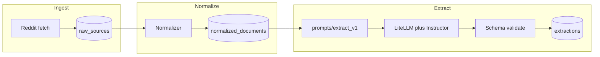

# Architecture (V1 pipeline)

## Goal

Sync pipeline that turns one Reddit thread into a persisted, schema-valid extraction.

```text
Reddit API / JSON
      ↓
  ingest (raw)
      ↓
  normalize
      ↓
  extract (LLM + Instructor)
      ↓
  validate (JSON Schema)
      ↓
  PostgreSQL
```

No dashboard, no workers cluster, no embeddings.

## Components



| Component | Responsibility | V1 interface |
|-----------|----------------|--------------|
| **Ingest** | Fetch post + top N comments; write `raw_sources` | CLI: `ingest-reddit --url` or `--id` |
| **Normalize** | Map raw Reddit → `NormalizedDocument`; upsert `normalized_documents` | Pure function + persist step |
| **Extract** | Call model with Instructor; fill `meta`; validate against `extraction.json` | CLI: `extract --document-id` |
| **Persist** | SQLAlchemy models; Alembic migrations | Shared DB session |

## Runtime choices (locked for week 1)

| Concern | Choice | Why |
|---------|--------|-----|
| API surface | Thin FastAPI optional; **CLI is the milestone** | Prove pipeline before HTTP |
| LLM access | LiteLLM + Instructor | Structured JSON, swappable models |
| Workers | **None** (sync process) | Celery/Temporal after CLI is solid |
| Sources | Reddit only | Other platforms share normalized schema later |
| Comment window | Top N by score (default **N = 20**), depth capped (default **depth ≤ 3**) | Pain often in comments; bound token cost |

## Idempotency

| Step | Behavior |
|------|----------|
| Ingest same `(platform, external_id)` | Return the existing immutable `raw_sources` row; never update its payload |
| Normalize same `(platform, external_id)` / `raw_source_id` | Return the existing immutable `normalized_documents` row |
| Extract identical result | Return the existing row using `(document_id, result_hash)` |
| Extract different result | Insert a new immutable `extractions` row |

No stage row is overwritten by the pipeline.

## Data contracts

| Stage | Schema |
|-------|--------|
| Raw Reddit payload | [`schemas/raw_reddit.json`](../schemas/raw_reddit.json) |
| Normalized document | [`schemas/normalized_document.json`](../schemas/normalized_document.json) |
| Extraction result | [`schemas/extraction.json`](../schemas/extraction.json) |
| Prompt policy | [`prompts/extract_v1.md`](../prompts/extract_v1.md) |

Validation failures fail the job; do not persist invalid `result`.

## Extraction input assembly

Build a single text block for the model:

1. Title
2. Body (`content`)
3. Comments in score order: `author | score | body` (truncated long bodies with a clear marker)

Do not send raw Reddit API JSON to the model.

## Failure modes

| Failure | Handling |
|---------|----------|
| Reddit fetch error | Exit non-zero; no DB write |
| Normalizer missing required fields | Exit non-zero; leave raw intact |
| LLM timeout / provider error | Exit non-zero; no extraction row |
| JSON / Instructor validation failure | Exit non-zero; no extraction row |
| Provenance span fails post-check | Reject extraction; treat as validation failure |

**Provenance post-check (required before persist):** for each evidence object, resolve the named field text (`title`, `content` as `body`, or `comments[id].body`), verify `0 <= start < end <= len(text)`, and keep the sliced span for review tooling. Invalid `comment_id` or out-of-range indices fail the job.

See [eval.md](eval.md) and [decisions.md](decisions.md).

## Folder layout (target when coding starts)

```text
signalmine/
  backend/
    ingestion/
    extraction/
    api/           # optional thin HTTP later
  workers/         # deferred
  frontend/        # deferred
  infra/
  prompts/         # already present
  schemas/         # already present
  docs/            # already present
  tests/
  raw/             # optional local fixtures; gitignore bulk dumps
```

Phase 0 only creates `docs/`, `schemas/`, and `prompts/`.

## Security & ops (minimal)

- Reddit credentials / OpenAI keys via environment variables only
- No secrets in repo
- Rate-limit Reddit fetches; cache raw payloads for eval replays

## Out of scope until eval gates pass

Embeddings, clustering, opportunity LLM, Elasticsearch, Next.js dashboard, auth.
