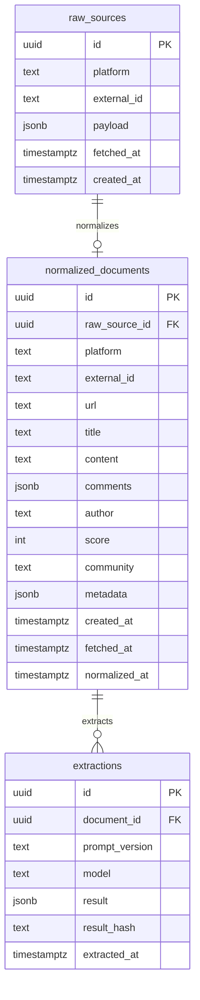

# V1 data model

PostgreSQL only. Three tables for the week-1 milestone. No `clusters`, `competitors`, `tags`, or embeddings until extraction quality is gated.

## Entity relationship

## Tables

### `raw_sources`

Immutable capture of provider payloads.

| Column | Type | Notes |
|--------|------|-------|
| `id` | `uuid` PK | Default `gen_random_uuid()` |
| `platform` | `text` NOT NULL | V1: `reddit` |
| `external_id` | `text` NOT NULL | Platform-stable id |
| `payload` | `jsonb` NOT NULL | Must validate as [`schemas/raw_discussion.json`](../schemas/raw_discussion.json) |
| `fetched_at` | `timestamptz` NOT NULL | When the API was called |
| `created_at` | `timestamptz` NOT NULL | Row insert time |

**Constraints**

- `UNIQUE (platform, external_id)` — an idempotent repeat returns the existing row. The insert-only repository never updates the stored payload.

### `normalized_documents`

One canonical discussion document per source thread.

| Column | Type | Notes |
|--------|------|-------|
| `id` | `uuid` PK | |
| `raw_source_id` | `uuid` NOT NULL FK → `raw_sources.id` | `ON DELETE RESTRICT` |
| `platform` | `text` NOT NULL | Denormalized for query convenience |
| `external_id` | `text` NOT NULL | Same as raw |
| `url` | `text` NOT NULL | |
| `title` | `text` NOT NULL | |
| `content` | `text` NOT NULL | May be empty string |
| `comments` | `jsonb` NOT NULL | Array of normalized comment objects |
| `author` | `text` NULL | |
| `score` | `integer` NOT NULL | |
| `community` | `text` NULL | Subreddit for Reddit |
| `metadata` | `jsonb` NOT NULL DEFAULT `{}` | |
| `created_at` | `timestamptz` NOT NULL | Source content created time |
| `fetched_at` | `timestamptz` NOT NULL | Copied from raw |
| `normalized_at` | `timestamptz` NOT NULL | When normalizer ran |

**Constraints**

- `UNIQUE (platform, external_id)`
- `UNIQUE (raw_source_id)` — one normalized doc per raw row in V1
- Row shape aligns with [`schemas/normalized_document.json`](../schemas/normalized_document.json)

### `extractions`

Versioned LLM outputs. Re-running extraction **inserts a new row**; never mutate prior results.

| Column | Type | Notes |
|--------|------|-------|
| `id` | `uuid` PK | |
| `document_id` | `uuid` NOT NULL FK → `normalized_documents.id` | `ON DELETE CASCADE` |
| `prompt_version` | `text` NOT NULL | e.g. `extract_v1` |
| `model` | `text` NOT NULL | |
| `result` | `jsonb` NOT NULL | Must validate as [`schemas/extraction.json`](../schemas/extraction.json) |
| `result_hash` | `text` NOT NULL | SHA-256 of canonical result JSON for idempotency |
| `extracted_at` | `timestamptz` NOT NULL | |

**Indexes**

- `(document_id, extracted_at DESC)` — latest extraction per document
- Optional later: GIN on `result` for JSON path queries

**Constraints**

- `UNIQUE (document_id, result_hash)` — inserting the exact same result is idempotent.
- There is intentionally no unique constraint on `(document_id, prompt_version)`. Different results from repeated runs remain separate immutable versions.

## Invariants

1. Raw payloads are never rewritten by the LLM path.
2. Normalization is pure / deterministic given a raw payload + normalizer version (normalizer version can live in `metadata` later; not required for week 1).
3. Every non-null `extractions.result` claim must carry at least one provenance span (`source`, `field`, `character_range`, `confidence`) that slices validly into the linked document’s title, body (`content`), or a comment body (`comment_id` required when `field` is `comment`).
4. `budget_owner.value` is always one of `true` | `false` | `unknown` — never a bare boolean in storage.
5. Persistence is insert-only. Idempotent conflicts return an existing row; stage rows are never updated.

## Deferred tables (do not create yet)

- `clusters`, `cluster_memberships`
- `competitors`, `tags`
- `embeddings` / pgvector columns
- `users`, `api_keys`

## Migration notes (when implementation starts)

- Enable `pgcrypto` or use Postgres 13+ `gen_random_uuid()`.
- Alembic migrations mirror this doc exactly for V1.
- pgvector extension is **not** enabled in the milestone migration.
